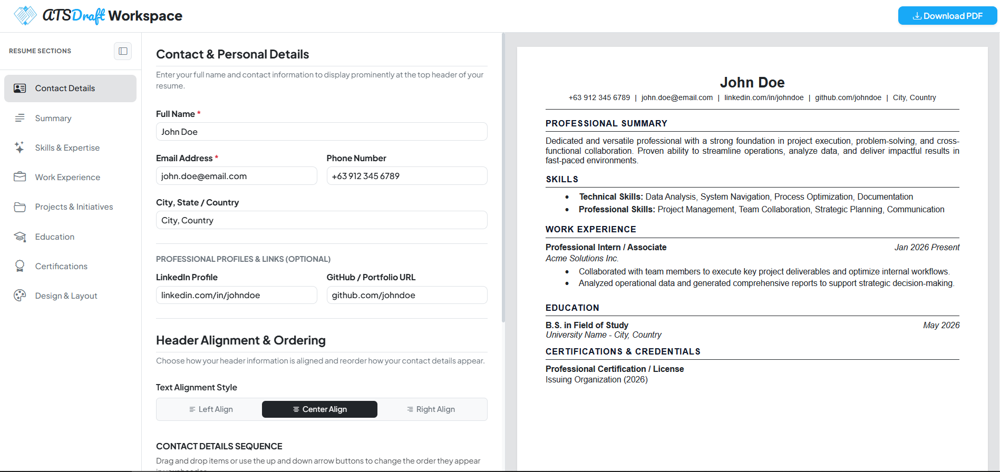

# ATSDraft — ATS-Friendly Resume Builder

**ATSDraft** is an interactive, web-based resume builder engineered to help job seekers create professional, Applicant Tracking System (ATS) optimized resumes.

---

## Key Features

- **Live Interactive Workspace:** Edit resume details with instant side-by-side desktop rendering or mobile-optimized previews.
- **ATS-Optimized Formatting:** Built upon clean typography, consistent structural hierarchy, and standard layouts that pass Applicant Tracking Systems with ease.
- **Modular Form Builder:** Organize and edit core sections seamlessly:
  - Contact Details & Social Links
  - Professional Summary
  - Skills & Expertise
  - Work Experience & Key Accomplishments
  - Projects & Key Initiatives
  - Education & Academic Credentials
  - Certifications & Licenses
- **Custom Layout & Design Control:** Adjust font sizes, heading font choices, primary title colors, and section order dynamically.
- **Instant In-Browser PDF Export:** Export clean, high-resolution A4-formatted PDF documents using `html2pdf.js` with no server processing delay.
- **Mobile-Responsive Drawer Interface:** Accessible slide-over navigation drawer, backdrop overlays, and in-browser mobile PDF preview modal for mobile users.

---

## Technology Stack

- **Framework:** [Next.js 16](https://nextjs.org/) (`^16.4.6`, App Router, Client Components) & [React 19](https://react.dev/) (`19.3.0`)
- **Frontend UI Library:** [Bootstrap 5](https://getbootstrap.com/) (`^5.3.8`) & [Bootstrap Icons](https://icons.getbootstrap.com/) (`^1.13.2`)
- **Styling & Fonts:** CSS3, Modern CSS Grid/Flexbox, [Geist & Plus Jakarta Sans](https://fonts.google.com/)
- **PDF Compilation:** [html2pdf.js](https://github.com/eKoopmans/html2pdf.js) (`^0.14.0`)
- **Analytics:** [Vercel Analytics](https://vercel.com/analytics) (`^2.0.1`)
- **Icons & Media:** Next.js Image Optimization
